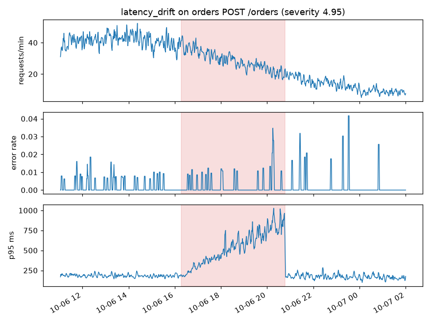
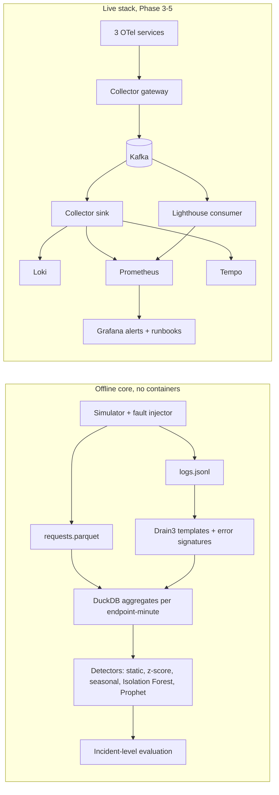

# Lighthouse


Log analytics and anomaly detection for microservices: OpenTelemetry telemetry through Kafka into Loki, Prometheus and Tempo, a Drain3 template pipeline, and seasonal, Isolation Forest and Prophet detectors scored at the incident level against labeled faults and a plain static-threshold alert.

> Status: Phase 1 of 5 done (simulator, parsing, aggregation). Detectors, the live stack and Kubernetes are described below as the plan and are marked as such until they land.

## Problem

An on-call engineer has a static alert (error rate above 5 percent, p95 above twice the SLO) and thousands of log lines per minute. The alert is quiet through slow latency drift, a new error that stays under the SLO, and a traffic drop caused by a routing fault, and it is loud on a planned traffic surge. The question this repo answers with numbers: do learned detectors catch those cases earlier or at all, and what do they cost in false alarms? If the ML loses to the threshold, the results say so.

## Demo

Example faults from the simulator (`docs/faults/`), here a latency drift that climbs for hours before it crosses 2x the SLO:



Dashboards, alerts and the end-to-end incident sequence are added in Phase 4 (`docs/screenshots/`).

## Architecture



The offline core generates 14 days of seeded traffic, logs and labeled faults, mines templates per service, and aggregates one table at (service, endpoint, minute) grain; every headline detection number comes from it. The live stack (planned for Phases 3 to 5) runs the same parsing and detectors on real services and produces a second, smaller evaluation from chaos runs.

## Tech stack

| Tool | Used for | Why |
|---|---|---|
| Python 3.12, uv | everything on the host | one lockfile, fast installs |
| NumPy, pandas, DuckDB, parquet | simulator and aggregation | vectorised sampling; SQL percentiles over millions of rows |
| Drain3 | log template mining | fixed-depth parse tree, online, persisted state |
| scikit-learn (Isolation Forest), Prophet | anomaly models (Phase 2) | one tree-based and one seasonal-forecast detector |
| OpenTelemetry, Kafka, Loki, Prometheus, Tempo, Grafana | live stack (Phase 3-4) | the usual open-source observability set |
| Docker Compose, kind | deployment (Phase 3-5) | one laptop, resource limits on everything |

## Quick start

Prerequisites: Python 3.12 and `uv`. The offline core needs no Docker.

```bash
uv sync
./scripts/check.sh                                   # lint, tests, eval smoke on the committed fixture
uv run python -m lighthouse.sim.run --out data/sim   # 14 days of traffic, logs and labeled faults
uv run python -m lighthouse.aggregate --source sim   # the per-endpoint per-minute table
./scripts/get_data.sh && uv run python -m lighthouse.parse.bench --all --sim-dir data/sim
```

## Results

Phase 1 results so far; detector results arrive with Phase 2 and the headline paragraph (who beat whom) goes here first.

| Result | Value | Command |
|---|---|---|
| Drain3 grouping accuracy, HDFS | 0.9975 | `python -m lighthouse.parse.bench --all` |
| Drain3, BGL | 0.8535 | same |
| Drain3, OpenStack (not tuned) | 0.2985, below the regex baseline 0.4815 | same |
| Drain3, Apache (not tuned) | 1.0000 | same |
| Simulator logs, per service | 1.0000 (regex baseline also 1.0) | same, `--sim-dir data/sim` |
| Simulated dataset | 5.29M requests, 657k log lines, 40 faults, 6 benign events | `python -m lighthouse.sim.run` |
| Aggregation, 14 days | 100,800 rows in 14.5 s, 1.1 GB peak | `python -m lighthouse.aggregate --source sim` |

Full tables with load averages: [RESULTS.md](RESULTS.md).

## How it works

**Simulator.** Rates follow a daily cosine (peak 14:00) times a weekend factor of 0.6 and slow AR(1) noise, sampled in one vectorised pass. Six fault types plus two benign events are scheduled in stratified slices so train, validation and test days each see every type.

**Templates and signatures.** Drain3 masks numbers, hex, IPs, UUIDs, block ids and durations, then clusters by token tree. An error signature is (service, template id, exception class) with a first-seen time, which makes "a new error template appeared in the last 24 hours" a feature.

**Aggregation.** One DuckDB query gives counts, error rate and p50/p95/p99 per endpoint-minute; signature features come from a cumulative sum over first-seen events and only read the past (a truncation test enforces it).

## Testing

`./scripts/check.sh` runs ruff, the pytest suite (offline, on the committed 2-day fixture) and, once Phase 2 lands, an evaluation smoke that must finish in under 2 minutes. Phase 1 has about 80 tests covering seasonality, determinism, each fault effect, parser metrics, restart-stable template ids and past-only features.

## Design decisions and trade-offs

Numbered in [DECISIONS.md](DECISIONS.md). The top three:
1. I inject the dependency-outage cascade with a labeled lag instead of simulating call propagation, because the evaluation needs a labeled cascade, not a causal model (D4).
2. Drain3 is tuned on HDFS and BGL only and reported untouched on OpenStack and Apache, where it does worse than a regex baseline (D5).
3. Simulator logs are parsed per service with a stricter threshold chosen on train days only (D6).

## Known limits and next steps

This is a portfolio-scale demo on one laptop, not a production system. Simulated faults are cleaner and easier than real incidents, so numbers from the simulator are optimistic. The regex baseline ties Drain3 on simulator logs because the simulator's fields are easy to mask. Next: detectors and incident-level evaluation (Phase 2), the live stack and chaos runs (Phases 3 and 4), and Kubernetes (Phase 5).

Loghub data (https://github.com/logpai/loghub) is used for research benchmarking only and is not committed. Please cite: Zhu et al., "Loghub: A Large Collection of System Log Datasets for AI-driven Log Analytics", ISSRE 2023. NAB: https://github.com/numenta/NAB.

## Project structure

```
lighthouse/
  sim/        traffic, faults, templates, logs, plots, run
  parse/      Drain3 wrapper, signatures, benchmark
  aggregate.py
config/       sim.yaml, slo.yaml, drain3.ini
scripts/      check.sh, get_data.sh, make_fixture.py, tune_drain.py
tests/        unit tests and the committed fixture
docs/         schema, fault plots, PR bodies, study guide, interview notes
```
